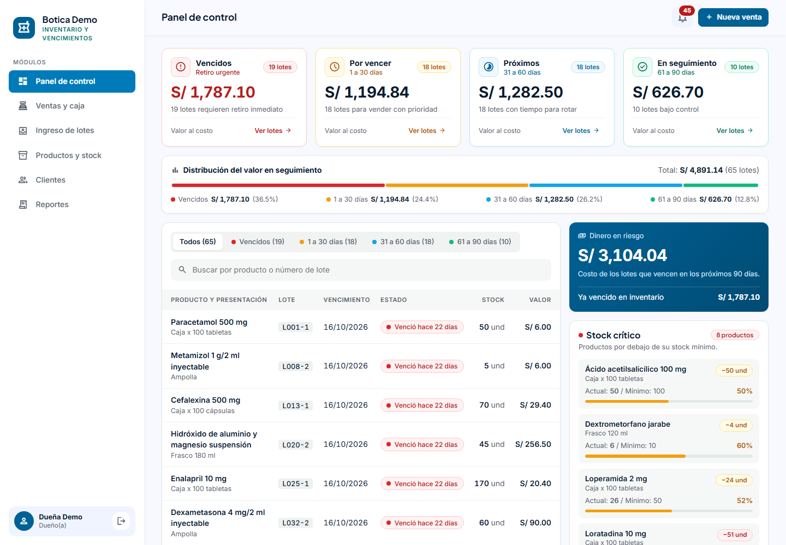
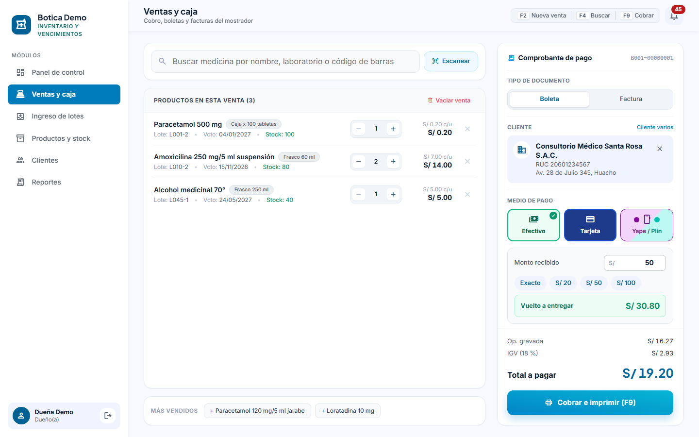
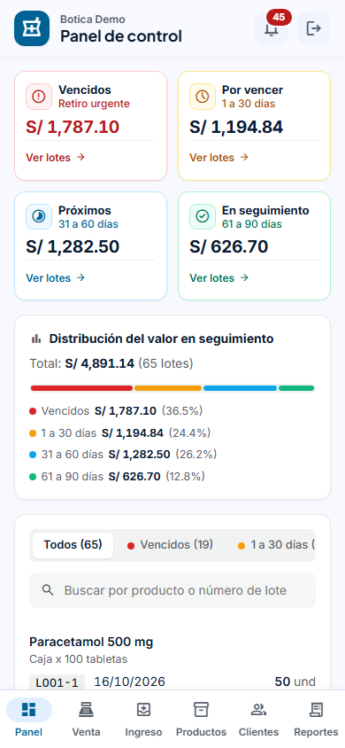
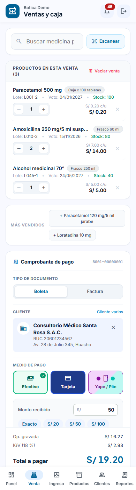
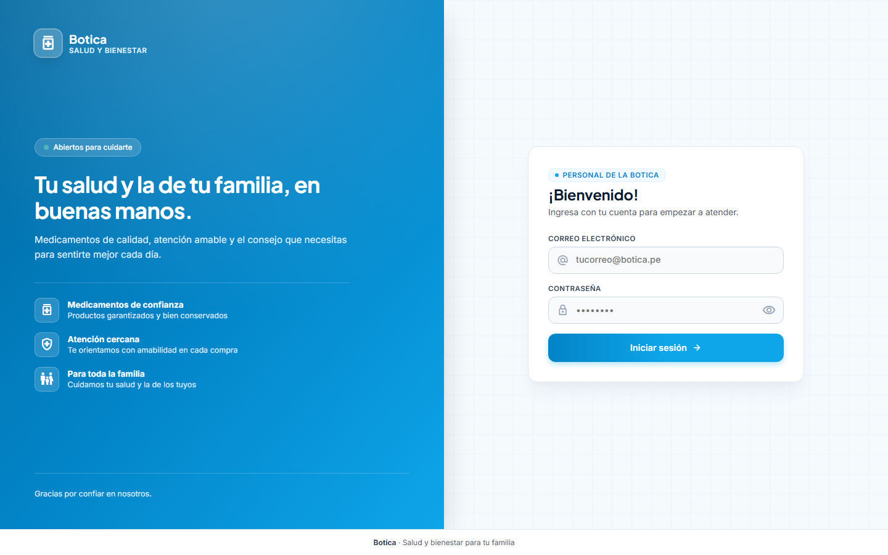

# Control de inventario y vencimientos para boticas y veterinarias

[](https://github.com/Ivan08v/Botica-Software/actions/workflows/ci.yml)

Sistema web para que un negocio pequeño sepa qué tiene en stock, qué está por vencer y cuánto dinero puede perder si no lo vende a tiempo. Pensado para boticas y veterinarias independientes de Huacho (Perú), y para usarse desde el celular en el mostrador.

Registra cada venta con su boleta o factura numerada y el medio de pago, pero no emite comprobantes electrónicos ante SUNAT: es un complemento de control de inventario.

### Panel de control

Tarjetas por grupo de vencimiento, distribución del valor en riesgo, tabla de lotes con pestañas y buscador, y stock crítico.



### Ventas y caja

Productos con el lote que sale por FEFO, boleta o factura numerada, cliente por DNI o RUC, medio de pago con vuelto e IGV separado.



### En el celular y el ingreso

| Panel en celular | Caja en celular | Ingreso al sistema |
| --- | --- | --- |
|  |  |  |

Las capturas usan los datos de demostración del seed; los clientes que aparecen son ficticios.

## Qué hace

- **Panel de control**: tarjetas con los lotes vencidos y por vencer a 30, 60 y 90 días y su valor, barra de distribución del dinero en riesgo, tabla de lotes con pestañas, buscador y paginación, y stock crítico con barra de avance hacia el mínimo.
- **Ventas con FEFO** (*first expired, first out*): al vender, el sistema descuenta primero del lote que vence antes y muestra en cada producto de qué lote entregar y cuándo vence.
- **Aviso de alertas en todas las pantallas**: una campana en la barra superior con los productos por reponer (debajo del stock mínimo) y los lotes vencidos o por vencer en 30 días. La ven la dueña y el vendedor.
- **Caja**: boleta o factura (numeradas B001 y F001, con el número del próximo comprobante a la vista), cliente por DNI o RUC (o se registra al momento), medio de pago (efectivo con vuelto, tarjeta, Yape o Plin), accesos rápidos a los más vendidos y atajos de teclado (F2 nueva venta, F4 buscar, F9 cobrar). Al cobrar muestra el comprobante para imprimir.
- **IGV**: los precios lo incluyen; en cada venta se separa la operación gravada del IGV (18 %) y se guardan los dos.
- **Clientes**: registrar, buscar, editar y eliminar (solo si no tiene compras), con DNI, carné de extranjería o RUC y dirección fiscal; su ficha muestra cuántas veces compró, cuánto gastó y qué llevó.
- **Ingreso de mercadería por lotes**, con número de lote, fecha de vencimiento, cantidad y costo.
- **Reportes en Excel y PDF**: inventario valorizado, lotes por vencer y ventas por período con el IGV separado y la ganancia bruta sin IGV.
- **Importación desde Excel** del inventario inicial, con vista previa y aviso de errores fila por fila.
- **Productos** con búsqueda y lectura de código de barras desde la cámara.
- **Dos roles**: `DUENO` (ve todo y configura) y `VENDEDOR` (registra ingresos y ventas).
- **Varios negocios** en la misma instalación: cada botica o veterinaria entra con su cuenta y solo ve sus datos.

## Tecnologías

| Parte | Stack |
| --- | --- |
| [backend/](backend/) | Node.js + Express 5 (JavaScript, módulos ES), Prisma 7, PostgreSQL 16, JWT, Zod, Jest |
| [frontend/](frontend/) | React 19 (JavaScript, `.jsx`), Vite, React Router, CSS propio (tipografías Inter y Plus Jakarta Sans, íconos Material Symbols), barcode-detector (ZXing en WebAssembly), SheetJS, jsPDF |

## Decisiones técnicas

- **El stock no se guarda, se calcula**: es la suma de los lotes no vencidos. No puede haber dos números que se contradigan.
- **Ventas concurrentes seguras**: cada venta corre en una transacción que bloquea los lotes con `SELECT ... FOR UPDATE`. Dos cajas no pueden vender la misma unidad, y hay pruebas automáticas que lo demuestran contra PostgreSQL real.
- **Defensa en capas contra la sobreventa**: validación de entrada, bloqueo en la transacción y un `CHECK (cantidad_actual >= 0)` en la base.
- **Aislamiento entre negocios**: el negocio viaja en el token firmado y todas las consultas filtran por él. Los datos de otro negocio responden 404.
- **Trazabilidad**: todo cambio de stock queda en la tabla `movimientos`.
- **Fechas en hora de Perú**: "hoy" se calcula en `America/Lima`, no con el reloj del servidor.

El detalle de cada una está en el [README del backend](backend/README.md).

## Cómo ejecutarlo

Requisitos: Node.js 24 y Docker Desktop.

```bash
# Terminal 1: base de datos y API (http://localhost:3001/api)
cd backend
npm install
cp .env.example .env        # y cambia JWT_SECRET
npm run db:up
npm run db:generate
npm run db:migrate
npm run db:seed
npm run start:dev

# Terminal 2: aplicación web (http://localhost:5173)
cd frontend
npm install
npm run dev
```

Cuentas de demostración que crea `npm run db:seed` (contraseña `Demo1234`). Son solo para probar: en una instalación real cámbialas.

| Correo | Negocio | Rol |
| --- | --- | --- |
| `dueno@demo.pe` | Botica Demo | Dueña |
| `vendedor@demo.pe` | Botica Demo | Vendedor |
| `veterinaria@demo.pe` | Veterinaria Demo | Dueño |

## Pruebas

```bash
cd backend
npm test            # unitarias
npm run test:e2e    # de extremo a extremo, en una base separada (botica_test)
```

En cada push a `main`, [GitHub Actions](.github/workflows/ci.yml) corre todo esto contra un PostgreSQL 16 real, además del linter y la compilación del frontend.

Cubren la validación de la importación, el reparto FEFO, stock insuficiente, lotes vencidos, ventas simultáneas, permisos por rol, aislamiento entre negocios, los cálculos del panel, la numeración de comprobantes (incluso con ventas simultáneas), el cálculo del IGV y el CRUD de clientes.

## Estado

Hecho: autenticación y roles, productos, lotes, ventas FEFO, caja con boleta o factura, medios de pago e IGV, clientes, panel, multi-negocio, importación desde Excel, reportes, la aplicación web e integración continua.

Pendiente: despliegue (Render o Railway para el backend, Vercel para el frontend).
